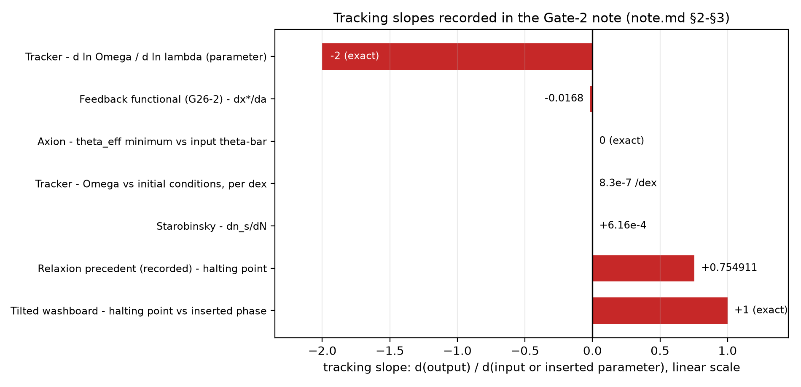

# The Derivation Era — the Gate-2 bundle

**Status: published in this repository on 2026-11-22, as authorised
by Rakshit. This repository is the publication of the Gate-2 bundle.**

Three results from an internal audit campaign (Waves 28–32) that asked,
for ten measured dimensionless numbers of physics: *can this number be
derived from a consistency condition, with no measured number used as an
input?* Each component below is stated at exactly the strength that
survived a two-half publication gate (novelty search + independent
re-verification; the novelty record is `novelty_search_log.md` and
the re-verification is in `verification/`).

## Contents

1. `note.md` — the publishable note:
   - **§1 The kernel of c_g = c.** The premise pair usually assumed for
     "gravity propagates at the same speed as light" — Lorentz-invariant
     vacuum, universal coupling — is not a pair of postulates. Universal
     coupling is a theorem (Weinberg 1964/65) given Lorentz invariance
     plus a massless spin-2 state; Lorentz invariance is a theorem
     (Ignatowski 1910 and successors) of kinematic axioms plus one
     empirical bit, κ > 0. The un-derived kernel is exactly
     {κ > 0 (empirical, irreducible by consistency), massless spin-2
     existence (open)}. Both theorems are classical and are credited to
     their authors; what this bundle claims is the *assembled premise
     ledger* for c_g = c, which a dedicated literature search did not
     find stated elsewhere (search boundary in `novelty_search_log.md`;
     "not found" is not proof of novelty).
   - **§2 Erasure vs selection, and a tracking-slope criterion.** A
     mechanism that *picks* a value halts where its inserted parameters
     tell it to; a mechanism that *erases* an input returns the same
     output regardless. The distinction is operationalised by the
     tracking slope (derivative of the output with respect to the
     mechanism's inserted parameters / the input being erased): ≈ 0 is
     erasure, ≠ 0 is picking. Applied to the QCD axion: its minimum
     drives θ_eff to the CP point 0 with slope exactly 0 (verified
     analytically at 50-digit precision), so the strong-CP problem is
     classified *solved-by-erasure under named premises* (Peccei–Quinn
     structure inserted; the axion is **undetected**; Vafa–Witten
     positivity; PQ quality). Honest credit: the distinction in
     substance is **implicit** in the literature ('t Hooft naturalness
     singles out symmetry-restoration points; the Barbieri–Giudice
     measure is a derivative-sensitivity criterion; the axion and
     relaxion literatures use "relaxes/cancels" vs "selects"). What was
     not found in print is the single-slope classifier applied across
     mechanism classes with computed slopes.
   - **§3 A ten-target taxonomy.** The audited status of ten ranked
     measured numbers (black-hole 1/4; c_g = c; α; sin²θ_W; m_p/m_e;
     lepton mass ratios; Ω_Λ/Ω_m; n_s; η_B; θ̄_QCD), each with its
     deciding computation and named remainder. Bottom line: no audited
     number is derived from consistency alone with zero remainder.
2. `novelty_search_log.md` — sources searched per component and the
   honest search boundary.
3. `verification/` — the gate's independent re-verification script
   (shares no code with the original wave scripts), its results, and
   its preserved failed runs.

## Limits, on the face of the bundle

- No unification is claimed. Nothing here passes any of the campaign's
  full gates G1–G10; there is no candidate theory in this bundle.
- The axion is an undetected particle; target 10's status is
  solved-by-erasure **under named premises**, not solved outright.
- κ > 0 is recorded as an empirical fact, not a derivation: Galilean
  kinematics is internally consistent, so no consistency argument can
  supply the bit.
- Novelty verdicts are bounded-search verdicts: (a) stated /
  (b) implicit / (c) not found in the searched sources. (c) is not a
  proof of novelty.

## Figures

Generated by `figures/make_figures.py` from this bundle's own
record (the gate-reproduced values are read from
`verification/g2_verify_results.json`; two values are transcribed
from `note.md`, as marked in the script); regenerate with
`python3 figures/make_figures.py` (requires matplotlib).

**Figure — the recorded tracking slopes.** The deciding slopes
of `note.md` §2–§3 on a linear scale, with the zero line that
separates erasure from picking. Erasure requires a slope of ≈ 0
with respect to *both* the input being erased *and* the
mechanism's inserted parameters, *and* zero measured inputs; the
tracker shows why both halves are needed — it erases its initial
conditions (8.3×10⁻⁷ per dex) but tracks its parameter λ with
slope −2, so it is filed as picking-by-parameters. The three
smallest slopes (axion exactly 0; tracker initial conditions;
Starobinsky +6.16×10⁻⁴, which is small but ≠ 0 and therefore
picking) appear as annotations at the zero line rather than
visible bars — that is the linear scale being honest, not
missing data. The axion, washboard, feedback-functional,
tracker-parameter, and Starobinsky slopes were reproduced by
the gate's verification (`verification/`); the tracker
initial-condition slope and the relaxion slope (+0.754911) are
the campaign's recorded values as stated in the note — the
relaxion slope in particular stands on its wave's record and
was **not** re-derived from scratch by Gate-2. What this figure
does **not** show: any slope not recorded in this bundle, and
no mechanism's full input ledger (those are in `note.md`).
